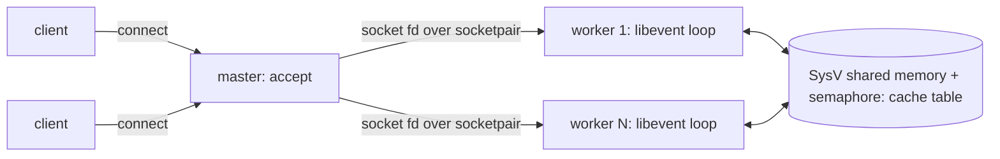

# network-servers

[](https://github.com/favorart/network-servers/actions/workflows/ci.yml)

Six small Linux network servers in C and C++, written in 2015 as homework for the Technosphere (Mail.Ru Group) course and brought into shape in 2026: one build, 145 unit and integration tests, every test also under ASan + UBSan in CI.

| Server | Language | I/O model | What it does |
|---|---|---|---|
| [cache-server](cache-server/) | C | libevent, master + worker processes, SysV shm + semaphore | key-value cache with TTL shared by all workers |
| [chat-server](chat-server/) | C, C++ client | epoll (edge-triggered), select client | line-based chat room: every line goes to every client |
| [dictionary-server](dictionary-server/) | C | libevent, pthread work queue | top-10 words of a Russian dictionary by prefix, with a cache |
| [http-server](http-server/) | C | libevent, master + worker processes, fd passing | static HTTP/1.0 server: GET, HEAD, POST; 200, 404 |
| [proxy-server](proxy-server/) | C | libevent bufferevents | TCP proxy that spreads clients over backend servers |
| [subscribe-server](subscribe-server/) | C++ | libevent | publish-subscribe over N message queues |

## Why

A server that waits for one slow client keeps every other client waiting. These six servers show the classic ways around it on Linux, each small enough to read in an evening: an epoll loop written by hand, libevent callbacks, a thread pool, and a master process that hands client sockets to worker processes. Each server has a README with a quick start, the protocol, a diagram of how it works, its tests and the bugs fixed in it. Use them to learn the models, to compare them under load, or as a starting point for a test harness of your own network code.

## Build and test

Linux only (epoll, SysV IPC, `/proc`). Dependencies are system packages:

```sh
sudo apt-get install libevent-dev libcmocka-dev libgtest-dev
make            # every server into <server>/build/
make test       # unit and integration tests
make test SAN=1 # the same under ASan + UBSan, in <server>/build-san/
make dist       # network-servers-<version>-linux-<arch>.tar.gz with all binaries
```

Each server folder has its own `Makefile` with the same targets. Every binary prints its version with `-v`/`--version`; the version comes from the git tag. Releases with the prebuilt binaries are on the [Releases](https://github.com/favorart/network-servers/releases) page.

## How the servers work

The cache and HTTP servers share one design: the master accepts connections and passes each client socket to a worker process over a UNIX socket pair (`SCM_RIGHTS`); the workers run their own libevent loops.



The shared table exists only in the cache server; the HTTP workers read files from the served directory. The other servers run one process:

- **chat-server** keeps a client table keyed by socket, reads lines with edge-triggered epoll and appends each complete line to the output buffer of every client; `EPOLLOUT` sends what the socket did not take at once.
- **dictionary-server** accepts connections in the main thread and hands each connection to a pool of threads through a queue; the thread serves that client until it disconnects, looks each prefix up in the cache (a 10 s TTL renewed on every hit) or scans the dictionary file and keeps the 10 heaviest words.
- **proxy-server** opens a connection to a randomly chosen backend for each client and pumps data both ways; EOF on one side shuts down writing on the other once its buffer is sent.
- **subscribe-server** keeps N queues; a subscriber gets every message published to its queue after it subscribed.

## Protocols and usage

| Server | Run | Request → reply |
|---|---|---|
| cache | `cache-server -p 8080 -w 4` | `set <ttl> <key> <value>` / `get <key>` → `ok <key> <value>` or `error : <text>` |
| chat | `chat-server -p 3100`, `chat-client -p 3100` | a line → the same line to every client; a new client gets `Welcome` |
| dictionary | `dictionary-server -p 8080 -d data/mydict.txt` | a prefix per line → up to 10 words, one per line, heaviest first |
| http | `http-server -d <dir> -p 8080 -w 4` | `GET`/`HEAD`/`POST` → `200` with an html or jpeg file, or `404` |
| proxy | `proxy-server -c proxy.conf` | bytes both ways; the config is `<listen port>,<ip>:<port>,...` ([example](proxy-server/proxy.conf.example)) |
| subscribe | `subscribe-server -p 3131 -q 4` | `publish <num> text` / `subscribe <num>` → literally `ok <que N>` or `error : <text>`; a subscriber gets `<que N>   text` |

Full usage with live sessions: [cache](cache-server/README.md), [chat](chat-server/README.md), [dictionary](dictionary-server/README.md), [http](http-server/README.md), [proxy](proxy-server/README.md), [subscribe](subscribe-server/README.md).

## Performance

Throughput and latency of every server with 1 and 16 clients; each server README explains its rows.

| Server | Scenario | Clients | Throughput, ops/s | p50, µs | p99, µs | Errors |
|---|---|--:|--:|--:|--:|--:|
| cache | get/set 9:1, 200 keys | 1 | 32173 | 29 | 45 | 0 |
| cache | get/set 9:1, 200 keys | 16 | 90528 | 163 | 471 | 0 |
| chat | line fan-out, delivered lines | 2 | 188 | 145 | 41027 | 0 |
| chat | line fan-out, delivered lines | 16 | 184522 | 320 | 41077 | 0 |
| dictionary | prefix, cache hit | 1 | 8376 | 118 | 149 | 0 |
| dictionary | prefix, cache hit | 16 | 13275 | 694 | 8027 | 0 |
| dictionary | prefix, cache miss | 1 | 90 | 11024 | 11486 | 0 |
| dictionary | prefix, cache miss | 16 | 203 | 78611 | 82774 | 0 |
| http | GET 118 B html, new connection | 1 | 5699 | 174 | 211 | 0 |
| http | GET 118 B html, new connection | 16 | 15678 | 898 | 3053 | 0 |
| proxy | echo 64 B, direct to the backend | 1 | 38432 | 27 | 38 | 0 |
| proxy | echo 64 B, through the proxy | 1 | 17524 | 54 | 75 | 0 |
| proxy | echo 64 B, direct to the backend | 16 | 166018 | 86 | 182 | 0 |
| proxy | echo 64 B, through the proxy | 16 | 36980 | 405 | 632 | 0 |
| subscribe | publish -> ok, 1 publisher | 1 | 34078 | 28 | 43 | 0 |
| subscribe | publish -> delivery to subscribers | 1 | 34078 | 41 | 57 | 0 |
| subscribe | publish -> ok, 1 publisher | 16 | 5317 | 187 | 216 | 0 |
| subscribe | publish -> delivery to subscribers | 16 | 85077 | 275 | 376 | 0 |

GitHub Actions `ubuntu-latest` runner, 3 s per scenario, measured by [bench/ns-bench.c](bench/ns-bench.c) in [this CI run](https://github.com/favorart/network-servers/actions/runs/45077696898) (release v0.0.11). Shared runners are noisy: compare the rows with each other, not with your machine. `make bench` reruns it; every push to `main` keeps a fresh table in the `bench` job summary.

## What the tests found

The 2015 code compiled only with warnings, and the tests written now failed on it. The main bugs, each fixed with a regression test:

- **chat-server**: clients were indexed by the epoll event slot, not by socket, so lines went to the wrong clients and even to the listening socket; the original course tests failed.
- **http-server**: the end of headers (`\r\n\r\n`) was searched over `sizeof(pointer)` bytes, so no request was recognized; `..` in the URI escaped the served directory.
- **cache-server**: the "shared" cache lived in a static array, so every worker had its own copy; the hash table lost keys after a miss.
- **dictionary-server**: the cache hashed garbage after the key's NUL and had no mutex; the top-10 was never sorted.
- **proxy-server**: EOF from either side always shut down the client socket; a config without backends divided by zero.
- **subscribe-server**: after the first error every later reply was an error.

## Limitations

- Linux only; no Windows or macOS build.
- Buffers of slow clients grow without a limit (chat, proxy, subscribe); no timeouts for incomplete requests.
- Small fixed sizes from the course: chat takes up to 31 clients, the cache table has 256 slots of int32 keys and values.
- dictionary-server keeps a thread per connected client, so `-w N` serves N clients at once; it reads the dictionary file on every cache miss.
- http-server has no request bodies, percent-decoding or 400 replies (a bad request just closes the connection).
- The multi-process mode of subscribe-server was never finished in 2015 and is removed: its queues would live in each process separately.
- `--help` is missing in the http, proxy and subscribe servers; they print usage on a wrong option.

## History

Each server was a separate repository; this one keeps their full histories in the subfolders. The servers were written by the author during the Technosphere course in 2015; in 2026 they got one build, CI with releases, English comments, warnings as errors, the bug fixes above and the tests.
