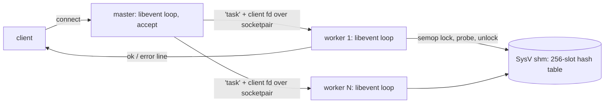

# cache-server

A key-value cache with TTL in C: the master process accepts connections and passes each client socket to one of its worker processes over a UNIX socket pair (`SCM_RIGHTS`), and all workers share one hash table in System V shared memory, guarded by a semaphore.

## Why

Worker processes scale over cores and isolate crashes, but they share nothing by default: a value set through one worker must be visible through every other. This server keeps the table in a SysV shared memory segment created before the fork and locks it with a SysV semaphore, so the code shows fd passing, shared memory between processes, a hash table with linear probing and expiry, and a clean shutdown that leaves no IPC objects behind. It was written in 2015 as homework for the Technosphere (Mail.Ru Group) course.

## Quick start

Linux only; needs `libevent-dev` (and `libcmocka-dev` for the tests).

```sh
make                                      # build/cache-server
build/cache-server -p 8080 -i 127.0.0.1 -w 2
```

In another terminal:

```console
$ printf 'set 60 1 100\nget 1\nget 2\nhello\n' | nc -q 1 127.0.0.1 8080
ok 1 100
ok 1 100
error : no such key in table
error : incorrect command to server
$ printf 'get 1\n' | nc -q 1 127.0.0.1 8080
ok 1 100
```

The second connection may land on another worker and still sees the key. On start the master prints its config (name, path, port, ip, workers, shm and semaphore ids) to stdout. `kill <pid>` (SIGTERM) or `Ctrl+C` stops the server: the master stops its workers, waits for them and removes the shared memory and the semaphore.

## Usage

```text
cache-server [-p|--port <port>] [-i|--ip <ipv4>] [-w|--workers <1..16>]
cache-server -v|--version | -h|--help
```

| Option | Default | Meaning |
|---|---|---|
| `-p`, `--port` | `8080` | listening port, 1..65535 |
| `-i`, `--ip` | `0.0.0.0` | listening IPv4 address |
| `-w`, `--workers` | `4` | number of worker processes, 1..16 |
| `-v`, `--version` | | print the version and exit |
| `-h`, `--help` | | print the usage and exit |

An invalid value prints the reason (`invalid number of workers '99': expected 1..16`) and exits with 1; an unknown option or an extra argument prints the usage and exits with 1. The version is the git tag when built by the top-level `make`, `0.0.0` when built in this folder.

The protocol is one command per line (`\n` or `\r\n`); keys, values and TTLs are 32-bit integers, and every command gets exactly one reply line.

| Request | Reply |
|---|---|
| `set <ttl> <key> <value>`, e.g. `set 60 1 100` | `ok 1 100`: the key lives `<ttl>` seconds |
| `get <key>`, e.g. `get 1` | `ok 1 100` |
| `get` of a missing or expired key | `error : no such key in table` |
| `set` when all 256 slots hold live keys | `error : cannot insert the key` |
| anything else: `hello`, `get x`, `set 10 abc 5` | `error : incorrect command to server` |
| a line longer than 1024 bytes without `\n` | `error : command too long`, the line is dropped |

A `set` of an existing key replaces its value and TTL. A command split across several packets waits for its end of line. Each bad command is also logged to stderr as `cache handling : Incorrect request command.`

## How it works



- Startup: the master creates the table (`hashtable_init()`: `shmget`, `shmat`, one semaphore set to 1), then forks the workers; each worker inherits the attached segment and keeps only its own end of its socket pair.
- Accept: `cache_accept_cb()` takes a connection and sends the 4-byte command `task` with the client fd (`SCM_RIGHTS`) to a worker picked by `rand()`, then closes its own copy.
- Commands: the worker wraps the fd in a bufferevent; `cache_handling()` reads complete lines with `evbuffer_readln()` and runs `hashtable_get()` or `hashtable_set()`, each under the semaphore (`SEM_UNDO`, so a killed worker does not leave it locked).
- Table: 256 slots of `{busy, key, value, expiry}` with linear probing; an expired record met during a probe is removed with backward-shift deletion, so the keys after it stay reachable.
- Shutdown: SIGTERM or SIGINT stops the master's loop; it closes its socket-pair ends, every worker sees end of stream and leaves its loop, the master `waitpid()`s for them and removes the segment and the semaphore (`IPC_RMID`).

## Tests

- `tests/test_hash.c`: set, get, overwrite, expiry, a full table, reuse of expired slots, keys kept after a miss, random operations checked against a simple model, and a table shared by a forked process.
- `tests/test_handling.c`: the command handler without sockets: replies, bad commands, an error that does not spoil the next replies, a command split across reads, an overlong line.
- `tests/test_config.c`: defaults, short and long options, invalid values, `--version` and `--help`, and the master-to-worker channel with fd passing.
- `tests/test_integration.c`: the real binary with 3 workers on a free port: set and get, a key seen by every worker, a split command, client sockets closed by the master, and SIGTERM that stops every process and leaves no shared memory or semaphore.

```sh
make test        # unit tests, then the integration test against build/cache-server
make test SAN=1  # the same under ASan + UBSan, in build-san/
```

## Performance

<!-- bench:cache-server -->

## Bugs fixed in 2026

- The "shared" cache was a static array, so every worker had its own copy: a key set through one connection was missing on another.
- The hash table lost keys after a miss, read past its array and could store one key twice.
- One bad command turned every later reply in the same packet into an error; a command split across packets was lost.
- The master leaked a descriptor per client, and a worker tried to serve fd -1 when the master went away.
- Shutdown crashed and left the shared memory and the semaphore in the system; options were not parsed properly.
- The code did not compile at all on modern GCC and Clang (missing headers and a missing global).

## Limitations

- Linux only (SysV IPC, `/proc/self/exe`, fd passing over UNIX sockets).
- Integer keys and values only; at most 256 live keys, with no eviction of live ones.
- One semaphore guards the whole table, so all workers serialize on every command.
- Workers are picked by `rand()` (never seeded), not by load.
- No timeouts for idle clients; no persistence: the cache dies with the master.

## History

Written in 2015 as practice 5 of the Technosphere course; originally `favorart/cache-server-libevent` (archived), moved into this repository with its full history.
