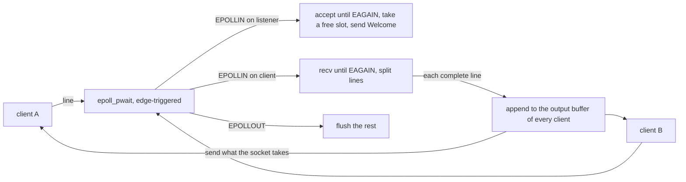

# chat-server

A line-based chat room in C: one process serves every client with edge-triggered `epoll`, and each line a client sends goes to all connected clients; a small C++ console client on `select()` comes with it.

## Why

A chat is the smallest server where clients talk to each other, not only to the server: one slow reader must not block the others, and a line may arrive in pieces or several at once. The code shows a single-threaded event loop on edge-triggered epoll (read and write until `EAGAIN`), per-client input and output buffers, and a client that multiplexes the keyboard and the socket with `select()`. It was written in 2015 as practice 2 of the Technosphere (Mail.Ru Group) course.

## Quick start

Linux only; no libraries needed (`libcmocka-dev` for the tests).

```sh
make                          # build/chat-server and build/chat-client
build/chat-server -p 3100
```

In a second terminal, the bundled client:

```console
$ build/chat-client -p 3100
Message from server: Welcome
```

In a third terminal, any line tool works too; type `hello`:

```console
$ nc 127.0.0.1 3100
Welcome
hello
hello
```

The second `hello` is the broadcast that came back, and the client in the second terminal prints `Message from server: hello`. The server logs to stdout: `accepted connection`, `message = 'hello'`, `connection terminated`. `kill <pid>` (SIGTERM) or `Ctrl+C` stops it with exit code 0.

## Usage

```text
chat-server [-p PORT] [-v]
chat-client [-p PORT] [-v]
```

| Option | Default | Meaning |
|---|---|---|
| `-p`, `--port` | `3100` | server: TCP port to listen on (all addresses); client: server port on `127.0.0.1` |
| `-v`, `--version` | | print the version and exit |
| `-h`, `--help` | | print the help and exit |

A port outside 1..65535 prints `invalid port '70000'`, an unknown option or an extra argument prints the help; both exit with 2. The version is the git tag when built by the top-level `make`, `0.0.0` when built in this folder.

The protocol has no commands: a message is a line ending with `\n`.

| Event | What the clients receive |
|---|---|
| a client connects | only this client gets `Welcome` |
| a client sends `hello\n` | every client gets `hello\n`, the sender included |
| a client sends `partial` and later ` line done\n` | every client gets `partial line done\n` once the line is complete |
| a line longer than 1024 bytes | every client gets it in pieces of 1024 bytes |
| a 32nd client connects | nothing: the server logs `too many clients` to stderr and closes it |

The client prints every chunk from the server as `Message from server: <text>`, sends each line typed on stdin and erases it from the screen; it exits on end of input or when the server closes the connection (`Server closed the connection`).

## How it works



- Client table: 31 slots of `struct messager_client` keyed by socket (`fd == -1` is free), each with a 1024-byte input buffer for the partial line and a growing output buffer.
- Read: on `EPOLLIN` (or an error or hang-up) `messager_client_receiving()` reads until `EAGAIN`; `messager_split_lines()` keeps the unfinished tail and hands every complete line to the broadcast.
- Write: `messager_client_send_other()` appends the line to every connected client and tries to send at once; whatever the socket does not take stays in the buffer and goes out on the next `EPOLLOUT`.
- Disconnect: end of file or a hard error on `recv()`/`send()` closes the socket and frees the slot; later events for it in the same batch are skipped.
- Shutdown: SIGINT and SIGTERM are blocked except inside `epoll_pwait()`, so none is lost; the handler sets a flag, the loop ends and every socket is closed.

## Tests

- `tests/test_chat.c`: line splitting without sockets (one line, a partial line, many lines in one chunk, long lines in parts, a callback error), clearing the buffers, a broadcast that reaches every client, and a flush that closes a dead peer.
- `tests/test_server.c`: the course scenarios against the real binary on a free port: connect, the count of accepted clients, reading one and many messages, no split of a message, disconnects, the greeting, echo, a broadcast to idle clients, and a broadcast after another client left.

```sh
make test        # unit tests, then the integration test against build/chat-server
make test SAN=1  # the same under ASan + UBSan, in build-san/
```

## Performance

The p99 of about 41 ms is most likely not the server loop: the sockets keep Nagle's algorithm on (no `TCP_NODELAY`), so a small line can wait for the delayed ACK of the previous one (about 40 ms on Linux). With 16 clients each line is delivered 16 times, hence the high count of delivered lines.

| Server | Scenario | Clients | Throughput, ops/s | p50, µs | p99, µs | Errors |
|---|---|--:|--:|--:|--:|--:|
| chat | line fan-out, delivered lines | 2 | 188 | 145 | 41027 | 0 |
| chat | line fan-out, delivered lines | 16 | 184522 | 320 | 41077 | 0 |

GitHub Actions `ubuntu-latest` runner, 3 s per scenario, measured by [bench/ns-bench.c](../bench/ns-bench.c) in [this CI run](https://github.com/favorart/network-servers/actions/runs/45077696898) (release v0.0.11). Shared runners are noisy: compare the rows with each other, not with your machine. `make bench` reruns it; every push to `main` keeps a fresh table in the `bench` job summary.

## Bugs fixed in 2026

- Clients were indexed by the epoll event slot, not by socket: lines went to the wrong clients and even to the listening socket, and the original course tests failed.
- Line splitting repeated the tails of chunks and subtracted lengths twice, so messages came out garbled.
- Clearing both buffers at once cleared nothing, partial sends lost data, and `EPOLLOUT` did not send the rest.
- A disconnect was missed after a stale `EAGAIN`, leaving dead clients in the table.
- The server had no clean stop on SIGINT or SIGTERM; the client did not compile at all (it used an undefined buffer size).

## Limitations

- Linux only (epoll); the server listens on all addresses, the client connects only to `127.0.0.1`.
- At most 31 clients; the next ones are closed at once without a message.
- No nicknames, rooms or history: a line carries no sender.
- A client that does not read makes its output buffer grow without a limit.
- No timeouts and no limit on the rate of messages.

## History

Written in 2015 as practice 2 of the Technosphere course; originally `favorart/chat-server-epoll` (archived), moved into this repository with its full history.
