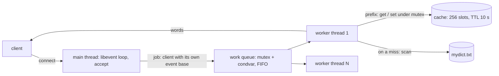

# dictionary-server

A prefix search server in C: the main thread accepts connections in a libevent loop and queues each one to a pool of pthreads, and a worker answers every prefix with the 10 heaviest words of a Russian dictionary, keeping recent answers in a shared cache with TTL.

## Why

A lookup that scans a 93,000-word file is too slow to run inside an event loop: it would stall every other client. Here the accepting thread never does the work; it hands connections to worker threads through a queue guarded by a mutex and a condition variable, and the threads share one hash table cache under a mutex. The code shows a hand-written work queue, a thread-safe cache with expiry and a top-N selection. It was written in 2015 as practice 6 of the Technosphere (Mail.Ru Group) course.

## Quick start

Linux only; needs `libevent-dev` (and `libcmocka-dev` for the tests).

```sh
make                          # build/dictionary-server
build/dictionary-server -p 8080
```

The server finds `data/mydict.txt` next to its `build/` folder. In another terminal:

```console
$ printf 'кот\n' | nc -q 1 127.0.0.1 8080
коттедж
котиковый
котонин
котильонный
котлетный
котлованный
котофей
котище
котурн
котлище
$ printf 'абаж\nзззз\n' | nc -q 1 127.0.0.1 8080
абажур
абажурный
```

`абаж` has only two words, `зззз` has none, so its reply is empty. The server prints its config and `listening on 0.0.0.0:8080`, then a debug log of every request to stdout. `kill <pid>` (SIGTERM) or `Ctrl+C` stops it with exit code 0 once the connected clients have left.

## Usage

```text
dictionary-server [-p PORT] [-i IP] [-w WORKERS] [-d DICT] [-v] [-h]
```

| Option | Default | Meaning |
|---|---|---|
| `-p`, `--port` | `8080` | TCP port, 0..65535; `0` takes any free port, shown in `listening on IP:PORT` |
| `-i`, `--ip` | `0.0.0.0` | IPv4 address to bind |
| `-w`, `--workers` | `4` | worker threads, 1..16 |
| `-d`, `--dict` | see below | dictionary file |
| `-v`, `--version` | | print the version and exit |
| `-h`, `--help` | | print the help and exit |

Without `-d` the server takes `./mydict.txt` if it exists, else `mydict.txt` next to the binary, else `../data/mydict.txt` from the binary's folder. A bad port or worker count prints `invalid port '...'` or `invalid number of workers '...'`, an unknown option prints the help; all exit with 2. The version is the git tag when built by the top-level `make`, `0.0.0` when built in this folder.

The dictionary is a UTF-8 text file with one `word weight` pair per line (weight 0..99); `data/mydict.txt` has 93,385 words. The protocol is one prefix per line (`\n` or `\r\n`), any number of lines per connection.

| Request | Reply |
|---|---|
| `кот` | up to 10 words starting with `кот`, one per line, heaviest first; equal weights keep the file order |
| `абаж` | the 2 words that match |
| `зззз` (no match) | nothing |
| an empty line | the 10 heaviest words of the whole dictionary |
| a prefix of 101 bytes or more | nothing; stderr gets `prefix longer than 100 bytes` |

Replies have no end marker and no error lines. The prefix is compared byte by byte, so case matters. If the dictionary file cannot be opened, every request gets an empty reply and stderr gets `dict file: No such file or directory`.

## How it works



- Accept: `srv_accept_cb()` takes a connection, creates a private `event_base` and a bufferevent for it and pushes a job to the queue; the main thread does nothing else.
- Work queue: `wque_push()` adds a job and signals the condition variable; a free worker takes the oldest job and runs that client's event loop until the client closes, so each worker serves one connection at a time.
- Lookup: for every line `find_words_prefix()` asks the cache; on a miss `dict_lookup()` reads the whole file and `dict_rec_add()` keeps the 10 heaviest matches in order; the answer is stored again with a fresh 10-second TTL.
- Cache: a hash table of 256 slots with linear probing over the prefix string, one mutex around every get and set; expired slots are reused.
- Shutdown: SIGTERM or SIGINT ends the main loop; `wque_free()` tells the workers to stop, drops the waiting jobs and joins the threads, then the cache is freed.

## Tests

- `tests/test_unit.c`: the cache (set and get, TTL, a hash that ignores bytes after the key's end, the last slot, random operations against a model, 4 threads at once, freeing NULL), the work queue (all jobs run, FIFO order, free joins the threads), the sorted top 10 and lookups in `tests/dict_small.txt`.
- `tests/test_integration.c`: the real binary on a free port with the small dictionary: one prefix, the top 10, several prefixes in one request, Cyrillic prefixes, 8 concurrent clients, SIGTERM, and `--version`.

```sh
make test        # unit tests, then the integration test against build/dictionary-server
make test SAN=1  # the same under ASan + UBSan, in build-san/
```

## Performance

<!-- bench:dictionary-server -->

## Bugs fixed in 2026

- The cache hashed garbage after the end of the key, so the same prefix missed the cache; it also read past its table and lost keys on collisions.
- The cache had no mutex, and it was freed while the worker threads still used it.
- A worker thread left its loop holding the queue mutex, threads were never joined, and jobs ran in LIFO order, so the first client waited longest.
- The top 10 was never sorted by weight.
- In a request of several lines the later answers kept leftovers of the first; a word longer than the buffer overflowed it.
- The code did not compile on GCC 14 and Clang 18 (implicit declarations).

## Limitations

- Linux only (`/proc/self/exe` to find the dictionary).
- One worker per connection: with `-w 4` a fifth client waits until one of the first four disconnects, and an idle client holds a worker forever.
- SIGTERM does not finish until every connected client has disconnected.
- Every cache miss reads the whole dictionary file again; replies have no end marker and errors give no reply.
- `-i` is not validated: a malformed address is not rejected.
- The debug log of every request always goes to stdout.

## History

Written in 2015 as practice 6 of the Technosphere course; originally `favorart/dictionary-server-libevent` (archived), moved into this repository with its full history.
