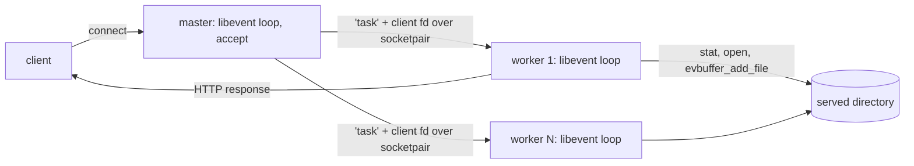

# http-server

A static HTTP/1.0 file server in C: the master process accepts connections and passes each client socket to one of its worker processes over a UNIX socket pair (`SCM_RIGHTS`), and every worker serves its clients in its own libevent loop.

## Why

A single-process server stalls everyone behind one slow client; a server that forks per connection pays for a fork on every request. This one forks a fixed pool once and hands sockets to it, so the code shows fd passing between processes, a non-blocking HTTP parser on libevent bufferevents and a clean shutdown of a process tree. It was written in 2015 as homework for the Technosphere (Mail.Ru Group) course.

## Quick start

Linux only; needs `libevent-dev` (and `libcmocka-dev` for the tests).

```sh
make                                   # build/http-server
mkdir -p site && echo '<h1>Hello</h1>' > site/index.html
build/http-server -h 127.0.0.1 -d site -p 8080 -w 2
```

In another terminal:

```console
$ curl -i http://127.0.0.1:8080/index.html
HTTP/1.0 200 OK
Server: http-server-hw
Date: Sun, 22 Nov 2026 22:03:32 GMT
Content-Type: text/html; charset=utf-8
Content-Length: 15
Connection: close

<h1>Hello</h1>
$ curl -i http://127.0.0.1:8080/missing.html
HTTP/1.0 404 Not Found
Server: http-server-hw
Date: Sun, 22 Nov 2026 22:03:33 GMT
Connection: close

```

`kill <pid>` (SIGTERM) or `Ctrl+C` stops the server: the master waits for its workers and exits with 0. Each request is logged to stderr (`http-server-hw: request received`).

## Usage

```text
http-server [-d <dir>] [-h <ip>] [-p <port>] [-w <num>] | -v
```

| Option | Default | Meaning |
|---|---|---|
| `-d`, `--dir` | `data/` | directory with the served files; must exist |
| `-h`, `--ip` | `0.0.0.0` | listening IPv4 address (`-h` is not help) |
| `-p`, `--port` | `8080` | listening port, 1..65535 |
| `-w`, `--workers` | `4` | number of worker processes, 1..16 |
| `-v`, `--version` | | print `http-server-hw <version>` and exit |

A missing or invalid value prints `Input incorrect user data.` to stderr and falls back to the default, so a start without `-h` prints that line too. An unknown option prints the usage line and the server still starts. The version is the git tag when built by the top-level `make`, `0.0.0` when built in this folder.

A request is `METHOD /path HTTP/1.0` (or `HTTP/1.1`), headers and an empty line; headers are read and ignored, and every connection serves one request (`Connection: close`).

| Request | Reply |
|---|---|
| `GET /index.html` (file exists) | `200 OK`, `Content-Type: text/html; charset=utf-8`, `Content-Length`, the file |
| `GET /cat.jpg` (file exists) | `200 OK`, `Content-Type: image/jpeg`, `Content-Length`, the file |
| `HEAD /cat.jpg` | the same headers as `GET`, no body |
| `POST /anything` | `200 OK` without a body; the request body is not read |
| a missing file, `/`, `/a.txt`, `/../secret.html` | `404 Not Found` |
| `BREW /pot HTTP/1.0`, a bad version, a head over 8 KiB | no reply: the connection is closed |

Only `.html`, `.htm`, `.jpeg` and `.jpg` files are served (case-insensitive). The path is taken as is: no percent-decoding, no query strings, no index file for `/`.

## How it works



- Startup: `http_server_workers_start()` creates a socket pair and forks for each worker; a worker keeps only its own end, the master keeps all of them and then opens the listening socket.
- Accept: the master's `http_accept_cb()` takes a connection and sends the 4-byte command `task` with the client fd (`SCM_RIGHTS`) to a worker picked by `rand()`, then closes its own copy.
- Request: the worker wraps the fd in a bufferevent; `http_request_parse()` waits until `\r\n\r\n` arrives (the head may come in pieces), parses the request line and maps the URI into the served directory.
- Response: headers go to the output buffer and the file is attached with `evbuffer_add_file()`; once it is sent, the worker half-closes the socket and waits up to 5 s for the client to close, so the response is not lost to a reset.
- Shutdown: SIGTERM or SIGINT stops the master's loop; it closes its socket-pair ends, every worker sees end of stream and leaves its loop, and the master `waitpid()`s for all of them.

## Tests

- `tests/test_request.c`: parsing and responses without sockets: methods, HTTP/1.0 and 1.1, malformed lines, a head split across reads, leading empty lines, a too long head, `..` traversal, content types, long URIs, a file deleted between parse and reply.
- `tests/test_config.c`: defaults and range checks of the options, short and long forms, `--version`, and the master-to-worker channel: fd passing, glued commands, end of stream, unknown commands.
- `tests/test_integration.c`: the real binary on a free port: GET of html, jpeg and a large file, HEAD, POST, 404, traversal, a request sent in parts, a bad request, clients that reset the connection, and SIGTERM that stops the master and every worker.

```sh
make test        # unit tests, then the integration test against build/http-server
make test SAN=1  # the same under ASan + UBSan, in build-san/
```

## Performance

<!-- bench:http-server -->

## Bugs fixed in 2026

- No request was ever answered: the end of headers `\r\n\r\n` was searched over `sizeof(pointer)` bytes instead of the whole buffer.
- A request that arrived in several packets was dropped, and `HTTP/1.0` requests were rejected.
- `GET /../secret.html` read files outside the served directory; an overlong URI was not checked against the path buffer.
- JPEG files had no `image/jpeg` type, replies had no `Date`, and `Connection: close` was not honored.
- `-w 0` made the master divide by zero on the first connection; out-of-range ports and worker counts passed the checks after truncation.
- Workers read uninitialized command bytes and lost commands glued in one read; the master did not stop on SIGTERM or wait for its workers.

## Limitations

- Linux only (`/proc/self/exe`, fd passing over UNIX sockets).
- One request per connection: no keep-alive, request bodies, percent-decoding or query strings.
- Malformed requests get no `400` reply, only a closed connection.
- Only html and jpeg files; no index file or directory listing.
- No timeout for a client that never finishes its request head.
- No `--help`: `-h` is the listening address.

## History

Written in 2015 for the Technosphere course; originally `favorart/http-server-libevent` (archived), moved into this repository with its full history.
