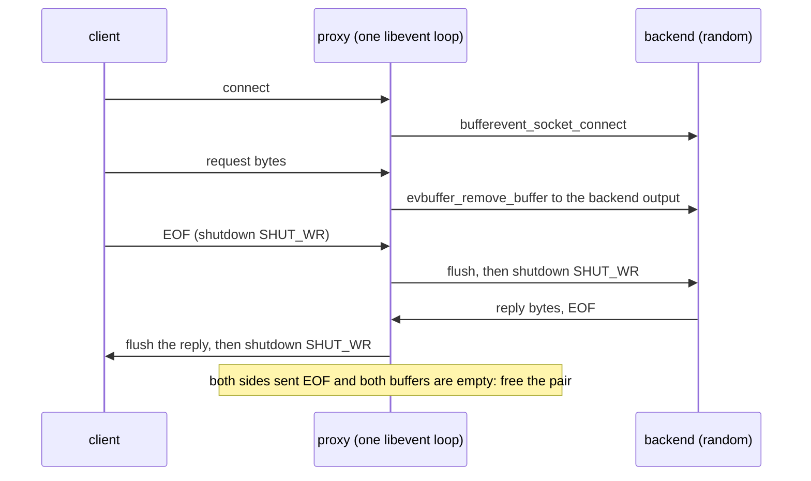

# proxy-server

A TCP proxy in C that connects every client to a randomly chosen backend from its config and pumps bytes both ways with libevent bufferevents, passing a half-close from one side to the other.

## Why

A load balancer in front of several identical servers is the simplest way to spread clients over them; this one shows how to do it in one process and one event loop. The code teaches non-blocking `connect` through `bufferevent_socket_connect()`, moving data between two buffers without copying, and correct EOF handling: a client that sends its request and closes its writing side still gets the whole reply. It was written in 2015 as homework for the Technosphere (Mail.Ru Group) course.

## Quick start

Linux only; needs `libevent-dev` (and `libcmocka-dev` for the tests).

```sh
make                                          # build/proxy-server
build/proxy-server -c proxy.conf.example      # listen on 8080, backends 127.0.0.1:9001 and :9002
```

Any TCP servers will do as backends. For a demo, two line-echo servers that sign their replies, each in its own terminal:

```sh
python3 -c '
import socketserver, sys
class H(socketserver.StreamRequestHandler):
    def handle(self):
        for line in self.rfile: self.wfile.write(sys.argv[1].encode() + b": " + line)
socketserver.ThreadingTCPServer(("127.0.0.1", int(sys.argv[2])), H).serve_forever()' backend-1 9001
```

and the same with `backend-2 9002`. Then each client lands on one of them:

```console
$ for i in 1 2 3 4; do echo "hello $i" | nc -q1 127.0.0.1 8080; done
backend-2: hello 1
backend-1: hello 2
backend-2: hello 3
backend-1: hello 4
```

The proxy prints its config at start; `Ctrl+C` or `kill` stops it.

## Usage

```text
proxy-server [-c <file>] | -v
```

| Option | Default | Meaning |
|---|---|---|
| `-c`, `--conf` | `config.txt` | config file; without `-c`, or if the file is missing, `config.txt` in the current directory |
| `-v`, `--version` | | print the version number and exit |

The config is one line: the listening port, then the backends, all separated by commas.

```text
8080,127.0.0.1:9001,127.0.0.1:9002
```

- The proxy listens on `0.0.0.0` at the given port; a bad port prints `Config file isn't correct.` and falls back to 8080.
- Backends are dotted IPv4 addresses with ports 1..65535; parsing stops at the first bad entry and keeps the ones before it.
- No valid backend at all: `No remote servers: Config file isn't correct.` and exit code 1.
- No config file at all: `Input incorrect user data.` twice, `No such file or directory`, exit code 1.

There is no protocol of its own: bytes from the client go to its backend and back unchanged.

| Event | What the proxy does |
|---|---|
| a client connects | picks a backend with `rand()` and connects to it; data the client sends meanwhile is buffered |
| one side sends EOF | delivers what is buffered for the other side, then shuts down writing to it; the other direction keeps working |
| both sides sent EOF | closes both connections once both buffers are flushed |
| the backend refuses or a socket errors | closes both connections; stderr gets `Error from bufferevent: 'Connection refused'` |

## How it works



- `struct client` holds the pair: the client bufferevent `b_ev`, the backend bufferevent `server` and `flag_close`, the number of sides that sent EOF.
- `proxy_read_cb()` serves both sides: it moves all input of one side to the output of its peer with `evbuffer_remove_buffer()`.
- `proxy_error_cb()` handles EOF: it moves the last input across, and if the peer still has output queued, `proxy_drained_cb()` shuts its writing side down after the flush; `proxy_try_close()` frees the pair at two EOFs and empty buffers.
- A socket error on either side frees both bufferevents at once; SIGPIPE is ignored, so a write to a closed peer is an error, not a crash.
- There is no signal handler: SIGINT or SIGTERM ends the process at once.

## Tests

- `tests/test_config.c`: config parsing: a valid file, port 65535, a bad listening port that falls back to 8080, a bad backend that stops parsing, no backends, a missing file, the default `config.txt`, the `-c` and `-v` options, and the spread of `proxy_choose_server()`.
- `tests/test_proxy.c`: the real binary with two echo backends: `--version`, a round trip, a 256 KiB request with a half-close that still gets the whole reply, 40 clients spread over both backends, a client or a backend closing first, clients that reset with 1 MiB in flight, and an unreachable backend that closes the client.

```sh
make test        # both test binaries against build/proxy-server
make test SAN=1  # the same under ASan + UBSan, in build-san/
```

## Performance

<!-- bench:proxy-server -->

## Bugs fixed in 2026

- EOF from either side always shut down the client socket, so a client that half-closed after its request lost the reply.
- A config without backends made the first connection divide by zero and crash the proxy.
- When the backend could not be connected, the client socket leaked and stayed open.
- A config file that could not be opened crashed on `fclose(NULL)`; the read buffer leaked; a long `-c` path overflowed a buffer.
- Port 65535 was rejected, and an octet over 255 overflowed the 16-byte address string.
- A client that disconnected early could kill the proxy with SIGPIPE; messages and usage texts were copied from the http server.

## Limitations

- Linux only.
- Random choice only: no health checks, no retry on another backend when one is down.
- Buffers grow without a limit when one side reads slower than the other writes.
- No timeouts: idle or half-open pairs stay forever.
- IPv4 only; the listening address is always `0.0.0.0`.
- No `--help` and no graceful shutdown; `-v` prints the bare version number without the server name.

## History

Written in 2015 for the Technosphere course; originally `favorart/proxy-server-libevent` (archived), moved into this repository with its full history.
