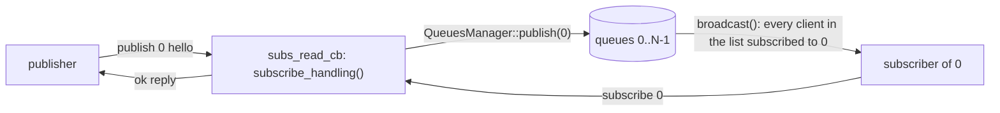

# subscribe-server

A publish-subscribe server in C++ with N message queues: clients publish lines into numbered queues or subscribe to them, and one libevent loop delivers every new message to the subscribers of its queue.

## Why

Publish-subscribe decouples the writers of messages from their readers: a publisher does not know who listens, a subscriber does not know who writes. The code shows a line protocol on libevent bufferevents with commands split across packets, fan-out of one message to many client buffers, and a clean shutdown on SIGINT. It was written in 2015 as homework for the Technosphere (Mail.Ru Group) course.

## Quick start

Linux only; needs `libevent-dev` (and `libgtest-dev` for the tests).

```sh
make                                              # build/subscribe-server
build/subscribe-server -h 127.0.0.1 -p 3131 -q 4
```

A subscriber in one terminal:

```console
$ nc 127.0.0.1 3131
subscribe 0
ok <que 0>
subscribe 2
ok <que 2>
```

A publisher in another:

```console
$ nc 127.0.0.1 3131
publish 0 hello
ok <que 0>
publish 1 nobody listens
ok <que 1>
publish 2 second queue
ok <que 2>
```

Meanwhile the subscriber's terminal shows:

```console
<que 0>   hello
<que 2>   second queue
```

The subscriber gets the messages of queues 0 and 2 only. `Ctrl+C` prints `Caught an interrupt signal;` and `Exiting cleanly in two seconds.`, then the server exits with 0.

## Usage

```text
subscribe-server [-h <ip>] [-p <port>] [-q <num>] | -v
```

| Option | Default | Meaning |
|---|---|---|
| `-h`, `--ip` | `0.0.0.0` | listening IPv4 address (`-h` is not help) |
| `-p`, `--port` | `3131` | listening port, 0..65535 |
| `-q`, `--queues` | `2` | number of queues, 1..255 |
| `-v`, `--version` | | print `subscribe-server <version>` and exit |

An invalid value silently falls back to the default. `-d`, `-w` and `-c` (with an argument) are accepted and ignored; an unknown option prints the usage and the server still starts. The version is the git tag when built by the top-level `make`, `0.0.0` when built in this folder.

One command per line (ended by `\n`, `\r\n` or `\r`); `<num>` is a queue number from 0.

| Request | Reply |
|---|---|
| `subscribe 0` | `ok <que 0>`; from now on every message published to queue 0 arrives as `<que 0>   hello` |
| `publish 0 hello` | `ok <que 0>`; the message goes to every current subscriber of queue 0, the publisher included |
| `publish 7 x` with 4 queues | `error : cannot insert the key` |
| `subscribe 9` with 4 queues | `error : no such query to subscribe` |
| `fetch 1`, `publish` without a number | `error : incorrect command to server` |

The message is the rest of the line after the number, leading space included, so a delivered line has three spaces after `<que N>`. Empty lines are skipped without a reply. A message published to a queue with no subscribers is dropped. An incomplete line waits for the rest; a line longer than 4096 bytes without a line end is dropped.

## How it works



- `struct server_config` holds the event base, the list of connected clients and the `QueuesManager` with N `std::queue<std::string>`.
- Each `struct client` has its bufferevent and a `std::set` of the queue numbers it subscribed to.
- On every read, `subscribe_handling()` runs each complete line and writes its reply; then `QueuesManager::broadcast()` empties all queues into the output buffers of the matching subscribers.
- EOF or an error on a client removes it from the list, so it gets no more messages.
- SIGINT exits the loop in two seconds; the clients are freed before the event base, then the queues.

## Tests

- `tests/test_unit.cpp`: queues (no news at start, resizing), command handling on plain buffers (replies, errors that do not stick to the next lines, an incomplete line, an overlong line, delivery only to subscribers, an empty message) and the config (defaults, valid values, out-of-range port and queue count, a too long address, the command line).
- `tests/test_integration.cpp`: the real binary on a free port: a subscriber gets only its queue, error replies, a command split across packets, a disconnected subscriber is forgotten, a clean stop on SIGINT with a client still connected, exit code 1 on a busy port, `--version`.

```sh
make test        # unit tests, then the integration tests against build/subscribe-server
make test SAN=1  # the same under ASan + UBSan, in build-san/
```

## Performance

<!-- bench:subscribe-server -->

## Bugs fixed in 2026

- After the first error every later reply on the connection was an error too.
- An out-of-range port or queue count was truncated instead of falling back to the default.
- The queues were reserved, not created, and their state was uninitialized, so publishing touched memory that was not a queue.
- An empty message (`publish 0`) read the byte before the string.
- A command split across two packets was discarded.
- Ctrl+C freed events after their event base, and a busy port crashed the server instead of exiting with an error.

## Limitations

- Linux only; one process and one thread.
- Messages are not stored: a subscriber gets only what is published after it subscribed, and there is no unsubscribe command.
- The output buffer of a slow subscriber grows without a limit.
- The 2015 multi-process mode was never finished and is removed: its queues would live in each process separately.
- No `--help`: `-h` is the listening address.

## History

Written in 2015 for the Technosphere course; originally `favorart/subscribe-server-libevent` (archived), moved into this repository with its full history.
